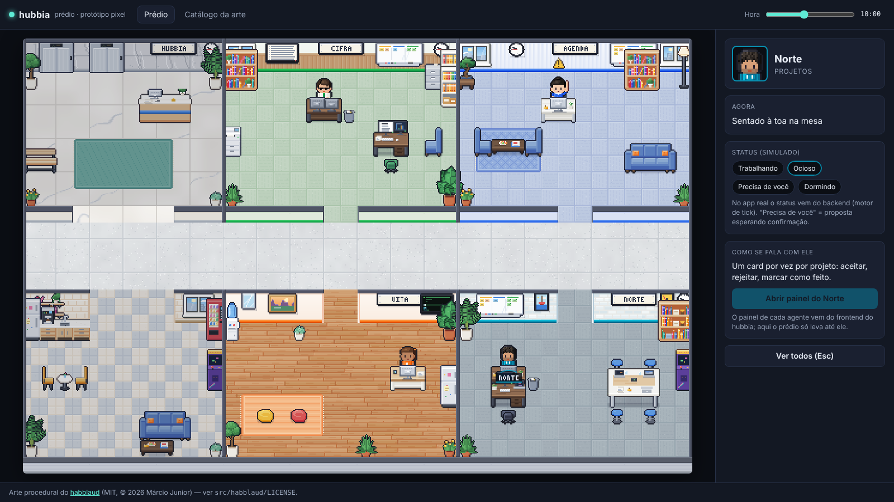

# Prédio hubbia — protótipo pixel



Protótipo independente (Vite + TypeScript, sem React) do "prédio" do hubbia desenhado com a **arte procedural do
[habblaud](https://github.com/marmottajr/habblaud)**: cada agente tem a sua sala, mobiliada pelo assunto dele, e o
térreo comum (recepção e copa) é onde eles se cruzam. O estudo completo está em `docs/estudo-habblaud.md`.

```bash
cd prototipos/predio-pixel
npm install
npm run dev        # http://localhost:5173  (#catalogo abre direto no catálogo)
npm run build      # typecheck + build
```

## O que tem

- **Prédio montado pelos agentes escolhidos**: recepção e copa fixas à esquerda; cada agente ocupa uma vaga (duas por
  coluna, acima e abaixo do corredor). "+ Adicionar agente" (ou clicar numa vaga) constrói a sala com animação de obra e o
  agente chega pelo elevador; "Dispensar" faz ele ir embora e a sala desmontada vira vaga. Sem vaga livre, o prédio ganha
  uma coluna (até 8 salas). As vagas ficam salvas neste navegador.
- **7 agentes no catálogo**: Cifra, Agenda, Vita e Norte (os que existem) e Lume (estudos), Lar (casa e compras) e Rota
  (viagens) como conceito — arte e sala prontas, backend ainda não.
- **Agentes com aparência fixa** (`src/agentes.ts`): roupa na cor do agente, acessórios que combinam com cada um.
- **Dinâmica** (`src/sim.ts`): caminho com A* na grade, pausas (estante, café, bebedouro, fliperama...), status
  `trabalhando` / `ocioso` / `precisa de você` (corre até a mesa e levanta a mão com o alerta) / `dormindo`.
- **Detalhes**: luz que apaga na sala vazia, telas que mudam com o status, elevador que abre quando alguém chega,
  quadro branco, relógio na hora real, janela e céu que seguem o controle "Hora".
- **Gaveta do agente**: clique num agente (ou na sala dele) — status simulável, o atalho de campo único da Vita
  e o lugar onde vai entrar o painel real de cada agente.
- **Catálogo**: agentes, as salas de cada um, as 20 poses, itens na mão, os 46 móveis, ícones, telas, pisos e paredes.

## Organização

| Pasta / arquivo | O quê |
| --- | --- |
| `src/habblaud/art/` | Módulo de arte do habblaud **sem alterações** (só os caminhos dos imports). Puro: PixelBuf → canvas, com cache. |
| `src/habblaud/shared/` | Dependências da arte: `appearance.ts`, `hash.ts`, `world/appearance-flat.ts` (cópias) e um `i18n.ts` mínimo. |
| `src/habblaud/LICENSE` | Licença MIT do habblaud — **precisa acompanhar** qualquer cópia da arte. |
| `src/agentes.ts` | Catálogo de agentes: identidade visual e textos. |
| `src/salas.ts` | Modelos de sala (móveis, lugares, piso, parede) — **um agente novo = uma entrada aqui e outra em agentes.ts**. |
| `src/predio.ts` | Monta o prédio a partir das vagas (salas, grade de caminhada), obra/desmontagem e desenho por quadro. |
| `src/sim.ts` | Comportamento dos agentes (sem DOM). |
| `src/main.ts` | Laço, câmera, seleção e gaveta. |
| `src/catalogo.ts` | Vitrine da arte. |

## Para levar ao frontend

O módulo `src/habblaud/` entra como está (é TypeScript puro com canvas 2D) e pode ser desenhado num canvas
próprio ou virar textura do PixiJS (`Texture.from(sprite.canvas)`). `predio.ts` e `sim.ts` são o ponto de
partida do escritório 2D descrito em `docs/frontend-design.md` ("Escritório 2D"); o status real viria do motor de tick.
